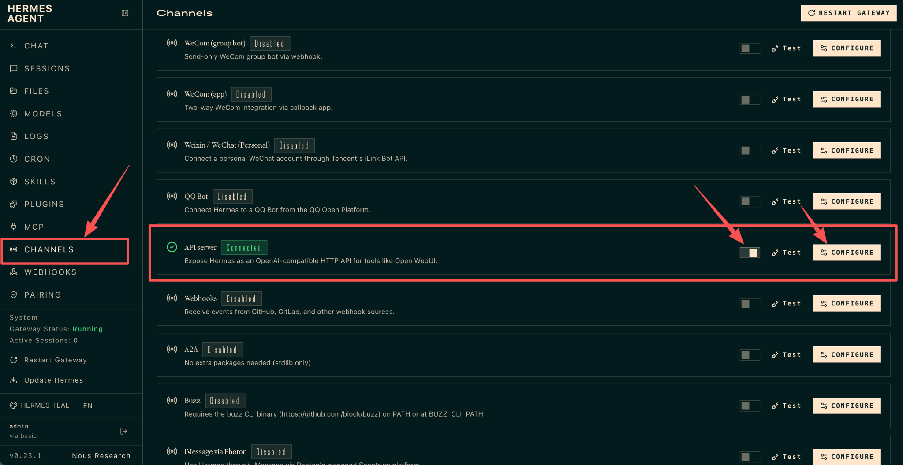

# Publish your Hermes endpoint over HTTPS

This guide is for a provider who already runs Hermes on an Ubuntu/Debian VPS and wants OpenAny to call its native API. It includes **enabling API Server, configuring its access key, keeping Gateway running, and configuring HTTPS**.

Toolkit version **0.1.1**. Follow this sequence: **save API settings → synchronize the private key file → start/restart Gateway once → verify locally → configure HTTPS → verify from a second host**. Do not continue past a failed check.

The result is:

```text
OpenAny → https://hermes.example.com → Nginx → http://127.0.0.1:8642
Your computer → SSH → your VPS (administration only)
```

Replace `hermes.example.com`, `203.0.113.10`, `ops@example.com`, and account/path placeholders with your own values. These example addresses are not a running service.

## 1. Prepare your VPS and domain

You need an existing Hermes installation with a working model provider, Python 3.9 or newer, sudo access, and a domain you control. This release uses systemd, Nginx's standard `conf.d` layout, and distribution-packaged Certbot with `certbot.timer`. Local-computer commands below assume a macOS/Linux terminal, or a suitably configured Linux environment such as WSL on Windows.

Create an A record pointing your hostname to the VPS's public IPv4 address. If you publish AAAA records, every IPv6 address must reach the same server. Remove stale records. Supply every intended A/AAAA address to the tool with repeated `--public-ip` arguments. DNS must resolve directly to those addresses; CDN proxy mode is outside this guide.

In your cloud security group and host firewall, allow inbound TCP 80 and 443. Keep your existing SSH access working. Hermes port 8642 should remain bound to loopback. The toolkit does not modify DNS, SSH or firewall rules.

Port 80 is needed for Let's Encrypt HTTP-01 validation and subsequent renewals. If your provider blocks it, use a separately configured DNS-01 solution instead of this installer.

## 2. Connect and upload the toolkit

Use your existing SSH connection. An optional entry in your local `~/.ssh/config` is:

```sshconfig
Host hermes-provider
    HostName YOUR_SERVER_IP
    User YOUR_HERMES_LINUX_USER
    IdentityFile ~/.ssh/YOUR_EXISTING_PRIVATE_KEY
    IdentitiesOnly yes
```

Use the account that owns the Hermes installation. Verify the server's host-key fingerprint through your hosting console on the first connection; do not disable SSH host-key checking. If you already use another login method, keep using it.

Get the ZIP and matching `.sha256` file from the [official GitHub release](https://github.com/openanysi/hermes-https-onboarding/releases/latest). In the local download directory, verify it on Linux with `sha256sum -c openany-hermes-https-onboarding-v0.1.1.zip.sha256`, or on macOS with `shasum -a 256 -c openany-hermes-https-onboarding-v0.1.1.zip.sha256`. Then unpack with `unzip openany-hermes-https-onboarding-v0.1.1.zip`. The toolkit directory is `hermes-https-onboarding`. You can also clone the source as shown in the README. Upload that directory from your computer:

```bash
scp -r hermes-https-onboarding hermes-provider:~/
ssh hermes-provider
cd ~/hermes-https-onboarding
python3 --version
```

If Python or the listener inspection tool is missing, install them on the VPS:

```bash
sudo apt-get update
sudo apt-get install -y python3 iproute2
```

Use a supported distribution whose Python version meets the minimum. OpenAny does not need your server password, private SSH key or cloud-console credentials. After each new SSH login, return to `~/hermes-https-onboarding` before running a `scripts/...` command.

## 3. Enable Hermes API Server and configure its key

**API Server runs inside Hermes Gateway.** There is no separate `APIService` daemon to install. Saving its configuration does not start the HTTP listener; Gateway must subsequently load that configuration.

### 3.1 Configure through the Dashboard (illustrated)

The screenshots below show Hermes **v0.23.1** and were supplied as configuration examples. Labels can differ between versions. The highlighted controls are the ones to use; the displayed connection state describes the example installation, not yours.

**Open your Dashboard.** Use its existing administration URL if you already have access. Otherwise, start it on the VPS under the same account and Hermes home, only if a Dashboard is not already running:

```bash
HERMES_HOME="$HOME/.hermes" hermes dashboard --host 127.0.0.1 --port 9119 --no-open
```

Keep that process running in **terminal A**. In a separate **terminal B on your computer**, forward the local administration port using your existing SSH connection:

```bash
ssh -o ExitOnForwardFailure=yes -N -L 127.0.0.1:19119:127.0.0.1:9119 hermes-provider
```

Open [http://127.0.0.1:19119](http://127.0.0.1:19119) in your computer's browser and sign in if prompted. This is an administration tunnel; it does not replace the public HTTPS API configured later. The Dashboard and the API listener are different ports. See the [official Dashboard guide](https://hermes-agent.nousresearch.com/docs/user-guide/features/web-dashboard) for version-specific startup options.

Both A and B are occupied by their foreground processes. Open **terminal C on your computer** for the remaining VPS commands:

```bash
ssh hermes-provider
cd ~/hermes-https-onboarding
```

Keep A and B running while you use the browser. If the tunnel reports that its local port is occupied, resolve that conflict before entering credentials. If your Dashboard has a profile selector, select **default**, corresponding to this guide's `$HOME/.hermes`; do not save to a named profile and then configure the default home with the script. For a separate isolated home, use its actual path throughout and confirm the Dashboard manages that same home.

**Step A — Find the API server channel.** Click **CHANNELS** in the left sidebar, locate the **API server** row, and click **CONFIGURE**. The toggle should ultimately be on; if it is already on, do not click it off.



*Figure 1. The supplied arrows identify Channels, the API server toggle, and Configure. The top-right Restart Gateway button is used after saving.*

[Open Figure 1 at full size](assets/hermes-channels-api-server.png)

**Step B — Fill in the API settings.** In **CONFIGURE API SERVER**, use the following values:

| Dashboard field | Value for this guide | Configuration variable |
| --- | --- | --- |
| **ENABLE API SERVER (TRUE/FALSE)**, marked **1** | `true` | `API_SERVER_ENABLED` |
| **API SERVER AUTH KEY**, marked **2** | Your existing Hermes Bearer key, or a newly generated strong unique key | `API_SERVER_KEY` |
| **API SERVER PORT** | `8642` | `API_SERVER_PORT` |
| **API SERVER HOST** | `127.0.0.1` | `API_SERVER_HOST` |
| **API SERVER MODEL NAME** | Keep the existing/default alias unless you intentionally need another | `API_SERVER_MODEL_NAME` |


*Figure 2. Set the enable field to true and configure the private auth key. Use the explicit port and host values in the table; the screenshot's redacted port/host placeholders are not configuration values.*

[Open Figure 2 at full size](assets/hermes-api-server-settings.png)

Keep an existing auth key instead of rotating it during onboarding. Password dots and `<redacted: ***>` are display placeholders, not credentials to copy. For a new key, the simplest route is to let the toolkit generate and save one using section 3.2 first; the Dashboard can then display it masked without you retyping it. If using a password manager, generate a random token of at least **32 characters using letters, digits, hyphen and underscore**. The toolkit accepts existing literal tokens of 16–512 characters using letters, digits or `._~+/=-`; shorter keys, obvious placeholders and other characters are rejected without automatically replacing the existing credential. Retain the actual value in your private credential store for OpenAny; a model-provider key or Dashboard login password is not the Hermes API key.

**Step C — Save and prepare the private key file.** Click **SAVE & ENABLE**. Dashboard configuration alone does not create this toolkit's `openany-api.key`. In your VPS terminal, run the following as the same Hermes user, without sudo:

```bash
python3 -B scripts/openany_hermes.py api-config --home "$HOME/.hermes" --require-existing-key --apply
```

Confirm the save succeeded before running this command. It reads that same home's saved `.env`, preserves its valid literal auth key, and writes the private key file used by the later checks. It also changes a known block-style API `enabled: false` setting in `config.yaml` to `true`, because an explicit YAML disable can prevent the API starting even when `.env` has API settings. Original files are backed up together. If you used the toolkit first, it reuses the existing key. Always use that same home and key.

Expected command output is `"ok": true`, `"mode": "apply"`, `"key_action": "reuse"`, and a `key_file` path in the selected home. `--require-existing-key` stops if the Dashboard key was not saved to that home; it does not silently generate a different key. Correct the save/profile/home and rerun. An error or unexpected home is not a completed setup.

**Step D — Restart and test.** After the save and key-file synchronization, use **RESTART GATEWAY** when existing tasks can be interrupted safely. Return to Channels and use **Test** on the API server row. The intended visible state is **Connected** with Gateway **Running**. If the Dashboard cannot restart a system service, use its authorized management method in section 4 instead of installing another service.

The Dashboard's Test/Connected state is a runtime indication. Continue with the authenticated check in section 5 and the external HTTPS check in section 7; it does not establish public reachability or successful task delivery.

### 3.2 Alternative: configure with the toolkit

If you completed the Dashboard route above, this configuration step is already done. Continue to the service information in section 4 and verification in section 5. If Gateway is already restarted and the check succeeds, no additional restart is needed.

Run the following as the Hermes Linux account, **without sudo**. For the default installation the configuration directory is `~/.hermes`. If you use a different isolated Hermes home, supply its actual path consistently. This release does not configure a multiplexed `/p/<profile>/...` endpoint.

Preview first:

```bash
python3 -B scripts/openany_hermes.py api-config --home "$HOME/.hermes"
```

Apply:

```bash
python3 -B scripts/openany_hermes.py api-config --home "$HOME/.hermes" --apply
```

The tool updates these four assignments in `~/.hermes/.env`, preserving your existing model-provider configuration:

```dotenv
API_SERVER_ENABLED=true
API_SERVER_HOST=127.0.0.1
API_SERVER_PORT=8642
API_SERVER_KEY=<YOUR_PRIVATE_HERMES_ACCESS_KEY>
```

The block above describes the settings; do not copy the placeholder as a real key. The tool generates a random key if none is configured, or preserves the valid literal key already present in `.env`. It removes duplicate managed assignments and writes `.env` and `~/.hermes/openany-api.key` with mode `0600`. If an API platform is explicitly disabled in an ordinary block-style YAML section (`platforms.api_server`, `gateway.platforms.api_server`, or `gateway.api_server`), it changes only that section's disabled flag to `true` and backs up `config.yaml` in the same transaction. Unrelated YAML values are preserved. Backups are saved under the private `~/.hermes/.openany-backups/` directory. The JSON output contains file locations, not the secret. YAML flow mappings, anchors and merges affecting these sections require normalization through Dashboard Save & Enable before this toolkit can proceed.

If your key is already configured only in `config.yaml`, the tool stops instead of silently replacing it. Open the files in a private editor, put the **same existing key** in `API_SERVER_KEY` in this home's `.env`, then rerun. Interpolated key expressions also require manual resolution. Environment overrides normally supply connection settings, but explicit YAML platform disablement is a separate gate; the synchronization above handles ordinary disabled flags. Check service-level environment overrides if the running API still does not use the saved settings.

For a manual setup, edit these four settings in the correct Hermes home's `.env`, use a strong unique Bearer key, and set `chmod 600 ~/.hermes/.env`. The automated path additionally writes the private standalone key file needed by its verification commands.

The three credential types have different purposes:

| Credential | Purpose |
| --- | --- |
| Model-provider API key | Hermes calling its configured language model |
| Hermes `API_SERVER_KEY` | OpenAny authenticating to your Hermes endpoint |
| Buyer's OpenAny API key | A buyer authenticating to OpenAny |

Do not substitute one for another. The Hermes key authorizes agent execution and should be stored in OpenAny's private upstream-credential field, never in a public product description or example.

## 4. Start Gateway and keep it running

First inspect the existing service, using the same Linux account and Hermes home as above:

```bash
HERMES_HOME="$HOME/.hermes" hermes gateway status
```

**If you already restarted Gateway after the final synchronization in section 3.1**, inspect its status and proceed to section 5. Do not restart it a second time merely to follow this section. **Otherwise, if Gateway is already managed as a service**, restart that existing service so it loads the API configuration:

```bash
HERMES_HOME="$HOME/.hermes" hermes gateway restart
HERMES_HOME="$HOME/.hermes" hermes gateway status
```

For a system-scoped installation, use the system service's documented management commands and required sudo privileges. Do not create a second user service alongside it. If using `systemctl` directly, confirm the unit belongs to this Hermes home; the default unit is usually `hermes-gateway`, while custom homes can have different names. Restarting an active Gateway can interrupt in-flight tasks, so choose an appropriate maintenance window.

**If no service exists**, the following user-service setup provides persistence and starts at boot with lingering enabled:

```bash
HERMES_HOME="$HOME/.hermes" hermes gateway install
sudo loginctl enable-linger "$(id -un)"
HERMES_HOME="$HOME/.hermes" hermes gateway start
HERMES_HOME="$HOME/.hermes" hermes gateway status
loginctl show-user "$(id -un)" -p Linger
```

Expected: Gateway is running and `Linger=yes`. This is an explicit installation step, not something the API configuration tool performs automatically. If `hermes` is not found, activate your existing Hermes installation or use its full executable path before installing the service.

For a temporary foreground diagnostic, use `HERMES_HOME="$HOME/.hermes" hermes gateway` only when no Gateway is already serving that home. A foreground process alone does not provide boot persistence.

## 5. Verify the local API before configuring HTTPS

```bash
python3 -B scripts/openany_hermes.py verify \
  --base-url http://127.0.0.1:8642 \
  --key-file "$HOME/.hermes/openany-api.key"
```

This makes only read-only discovery requests. It checks that unauthenticated requests are rejected, the saved key works, capabilities advertise run creation/status, and the Skill list has a supported structure. It supports both a legacy array and the current `{"object":"list","data":[...]}` Skill envelope.

A successful result includes `"authenticated": true` and `"model_tasks_started": 0`. An empty Skill list is allowed for transport verification; install your intended Skill before listing a product. This check does not prove model execution or business settlement.

For an unauthenticated diagnostic, this request should return HTTP 401 or 403:

```bash
curl -i http://127.0.0.1:8642/v1/skills
```

## 6. Configure Nginx, HTTPS and renewal

Run a read-only system check with sudo so listening process names are visible:

```bash
sudo python3 -B scripts/openany_hermes.py check \
  --domain hermes.example.com \
  --public-ip 203.0.113.10 \
  --key-file "$HOME/.hermes/openany-api.key"
```

If Nginx/Certbot is not installed, the check reports missing dependencies. Preview the intended setup:

```bash
sudo python3 -B scripts/openany_hermes.py https \
  --domain hermes.example.com \
  --public-ip 203.0.113.10 \
  --email ops@example.com \
  --key-file "$HOME/.hermes/openany-api.key" \
  --install-deps
```

Preview does not inspect or change the server; use `check` for actual read-only diagnostics. To apply, add `--apply`:

```bash
sudo python3 -B scripts/openany_hermes.py https \
  --domain hermes.example.com \
  --public-ip 203.0.113.10 \
  --email ops@example.com \
  --key-file "$HOME/.hermes/openany-api.key" \
  --install-deps \
  --apply
```

Applying permits installation of missing distribution packages and agrees to the Let's Encrypt terms through Certbot using your contact email. It creates an isolated managed site, validates Nginx before reloading, issues a webroot certificate, enables `certbot.timer`, installs a successful-renewal reload hook, and verifies the resulting HTTPS endpoint. Existing overlapping sites or unmanaged target files cause an error rather than being overwritten.

The managed files are:

- `/etc/nginx/conf.d/openany-hermes-hermes.example.com.conf`
- `/etc/letsencrypt/live/openany-hermes-hermes.example.com/` (Certbot-managed certificate lineage)
- `/etc/letsencrypt/renewal-hooks/deploy/openany-hermes-hermes.example.com`
- `/var/lib/openany-hermes/backups/` (private configuration snapshots)
- `/var/lib/openany-hermes/acme/` (public ACME validation files)

The proxy preserves the native request URI, JSON body, Bearer credential and idempotency header. SSE buffering and proxy retries are disabled. The initial route set permits `POST /v1/runs`, `GET /v1/runs/{id}`, `GET /v1/runs/{id}/events`, `GET /v1/capabilities`, `GET /v1/skills`, and `GET /v1/health`. Other routes, including the dashboard, session administration and Chat Completions, are not exposed by this profile. The request-body limit is 10 MiB and the upstream read timeout is 3,600 seconds.

The setup does not enable CORS. Server-to-server OpenAny requests do not need browser CORS settings. If you need another API surface, review and explicitly extend the profile rather than exposing the entire Hermes listener.

## 7. Verify from outside the VPS

Run the same verification on a separate computer or OpenAny's authorized integration host. In a new terminal **on your computer, outside the VPS SSH session**, change to your locally unpacked toolkit directory. Transfer only the standalone key file using your existing SSH alias, then run:

```bash
install -d -m 700 "$HOME/.config/openany-hermes"
scp hermes-provider:.hermes/openany-api.key "$HOME/.config/openany-hermes/openany-api.key"
chmod 600 "$HOME/.config/openany-hermes/openany-api.key"
```

The remote `.hermes` path assumes this guide's default home; substitute your actual isolated home if different. Do not transfer the entire `.env` file. Verify using this local file:

```bash
python3 -B scripts/openany_hermes.py verify \
  --base-url https://hermes.example.com \
  --key-file "$HOME/.config/openany-hermes/openany-api.key"
```

Verification checks the system trust store and hostname; it never disables TLS verification or follows redirects with your key. A successful check performed only on the VPS does not prove that OpenAny's network can reach it.

In a private editor, read `openany-api.key` and paste its value into OpenAny's upstream credential field. The installer does not print the value. Do not upload your whole `.env` file or SSH private key.

If you later change the API auth key in the Dashboard, repeat **Save → api-config synchronization → Gateway restart → local verification**, securely update the local copied key and OpenAny's upstream credential, and verify HTTPS again. A previously copied key file does not automatically follow a later Dashboard edit.

## 8. Configure OpenAny

Use these values in the Hermes-compatible provider setup available in your OpenAny environment:

| Setting | Value |
| --- | --- |
| Upstream origin/base URL | `https://hermes.example.com` |
| Upstream creation path | `/v1/runs` |
| Method | `POST` |
| Upstream authentication | `Authorization: Bearer <HERMES_API_SERVER_KEY>` |
| Capability discovery | `https://hermes.example.com/v1/capabilities` |
| Skill discovery | `https://hermes.example.com/v1/skills` |
| Upstream task status | `https://hermes.example.com/v1/runs/{run_id}` |

Keep the base URL as the origin when configuring `/v1/runs` separately; do not accidentally produce `/v1/v1/runs`. OpenAny's Hermes async adapter must be available in the target environment. This toolkit configures connectivity; it does not install or deploy that adapter.

Multiple Skill products can share the same origin and upstream path, with their own product price and fixed request instructions. For example, when using an OpenAny form that supports `fixed_body`, the corresponding upstream body fragment is:

```json
{
  "instructions": "Use the installed space-xhs-title Skill for this task."
}
```

Use the actual installed Skill name and your environment's supported adapter fields. `instructions` guides the agent; it is not a tool-access sandbox or a guarantee of Skill execution. Product configuration, actual task output, hosted-file delivery and billing need separate business validation.

## 9. Optional functional task test

This step may invoke your configured model and incur usage charges. It is not run by the installer. Replace the credential and install the named Skill before running it:

```bash
curl --fail --silent --show-error \
  'https://hermes.example.com/v1/runs' \
  -H 'Authorization: Bearer <HERMES_API_SERVER_KEY>' \
  -H 'Content-Type: application/json' \
  -H 'Idempotency-Key: <UNIQUE_PER_LOGICAL_TASK>' \
  --data '{"input":"Write three titles for a commuting breakfast post.","instructions":"Use the installed space-xhs-title Skill for this task."}'
```

Use the returned `run_id` for status:

```bash
curl --fail --silent --show-error \
  'https://hermes.example.com/v1/runs/<RUN_ID>' \
  -H 'Authorization: Bearer <HERMES_API_SERVER_KEY>'
```

Do not repeatedly submit a new run to obtain its result. Inspect terminal status and output; HTTP 200 on a status request alone does not prove successful execution. A direct Hermes test does not validate an OpenAny buyer charge.

## 10. Renewal and recovery

Inspect the renewal schedule and, when ready, explicitly test renewal against the CA's staging service:

```bash
sudo systemctl status certbot.timer
sudo systemctl list-timers certbot.timer
sudo certbot renew --cert-name openany-hermes-hermes.example.com --dry-run --run-deploy-hooks
```

An enabled timer is not proof that future renewal will succeed. Keep DNS and port 80 working. If a renewal succeeds but the deploy hook fails, inspect Nginx and reload it after correcting the error. Certbot hook errors require log review even when its overall exit status is zero.

For HTTPS configuration recovery, use the `backup` path reported by setup. Preview first, then apply:

```bash
sudo python3 -B scripts/openany_hermes.py restore \
  --domain hermes.example.com \
  --backup /var/lib/openany-hermes/backups/<SNAPSHOT_ID>
sudo python3 -B scripts/openany_hermes.py restore \
  --domain hermes.example.com \
  --backup /var/lib/openany-hermes/backups/<SNAPSHOT_ID> \
  --apply
```

For API configuration recovery, run as the Hermes account with the API setup's own snapshot:

```bash
python3 -B scripts/openany_hermes.py restore \
  --home "$HOME/.hermes" \
  --backup "$HOME/.hermes/.openany-backups/<SNAPSHOT_ID>" \
  --apply
```

Restart the matching Gateway after restoring its configuration. Restoring an old key also requires updating the corresponding OpenAny upstream credential. Newly installed packages, service enablement, registered CA accounts and issued certificates are not uninstalled/revoked by configuration rollback.

## Troubleshooting

| Symptom | Check |
| --- | --- |
| Port 8642 refuses connections | Correct Linux account/home, API switch, Gateway status, and logs |
| Verification returns unauthorized | Correct Hermes access key, selected home/profile, and service environment overrides |
| DNS mismatch | Every A/AAAA record, propagation, and CDN proxy mode |
| Port 80/443 conflict | Existing Nginx/Apache/Caddy/container listeners; resolve explicitly |
| Existing `server_name` conflict | Review the current site instead of creating a duplicate |
| Certificate issuance fails | Public port 80, cloud security group, firewall, AAAA reachability, and `/var/log/letsencrypt/letsencrypt.log` |
| HTTPS works locally but not externally | Cloud firewall, DNS from a second host, NAT routing and TLS chain |
| `certbot.timer` missing | Install the distribution Certbot package or integrate your existing renewal mechanism manually; Snap/custom layouts are not handled automatically |
| Skill count is zero | Install the intended Skill in the same Hermes home; connectivity checks alone do not install Skills |

Keep your SSH session open when diagnosing configuration failures. Inspect `sudo nginx -t`, `sudo journalctl -u nginx`, and the journal for your actual Hermes service. Review logs privately before sharing them.

## Official references

- [Hermes API Server configuration and native endpoints](https://hermes-agent.nousresearch.com/docs/user-guide/features/api-server)
- [Hermes Gateway service management](https://hermes-agent.nousresearch.com/docs/user-guide/messaging)
- [Hermes Dashboard: startup and Channels controls](https://hermes-agent.nousresearch.com/docs/user-guide/features/web-dashboard)
- [Current Hermes API Server source, including the Skill-list envelope](https://github.com/NousResearch/hermes-agent/blob/main/gateway/platforms/api_server.py)
- [Nginx proxy module](https://nginx.org/en/docs/http/ngx_http_proxy_module.html)
- [Certbot webroot, renewal and hooks](https://eff-certbot.readthedocs.io/en/stable/using.html)
- [Let's Encrypt HTTP-01 validation](https://letsencrypt.org/docs/challenge-types/)
