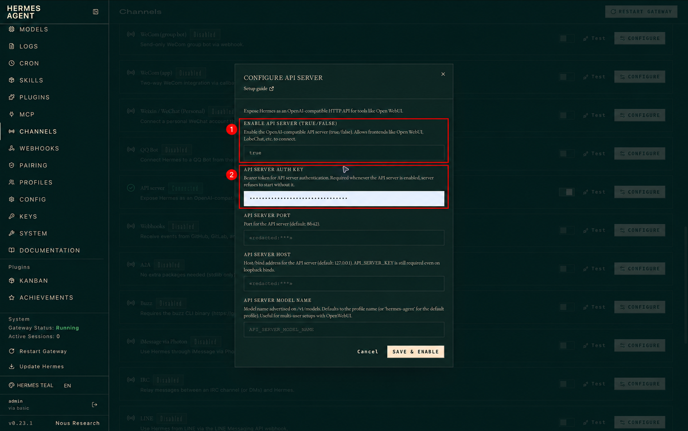

# Hermes one-click production connection guide

<!-- Generated from the template and the release manifest. Do not edit the generated file. -->

**v0.3.2 · production only · async / http_json / poll · public /openany/v1/**

Published installer v0.3.2. Verify the production manifest against the official stable release before setup.

Give this guide to the Agent managing your server. The OpenAny installer configures an **existing Hermes**: API enablement, private credentials, a production CLI relay and HTTPS routing. It does not install or upgrade Hermes. Use the preparation path below if Hermes is absent. Keep the copied instruction short; follow all detailed steps here.

## Copy this instruction to your Agent

```text
Read https://github.com/openanysi/hermes-https-onboarding/releases/download/v0.3.2/GUIDE.en.md.

Follow its production poll-mode guide to connect my existing Hermes to OpenAny, including API, Seller Key and HTTPS setup. Reuse existing configuration and keep credentials private. Guide me through missing prerequisites, confirm necessary changes with me, then complete and verify the approved setup.

Complete connection setup only. Ask before publishing or running paid tasks. Stop if the guide cannot be read.
```

## 1. Verify the release and prepare the server

Use one production source: this guide and [its release manifest](https://github.com/openanysi/hermes-https-onboarding/releases/download/v0.3.2/hermes-release.json). Before a published installation, compare the manifest with the [official stable release](https://github.com/openanysi/hermes-https-onboarding/releases/latest); stop if the manifest is missing, the version differs or verification is unavailable. Resolve the version once, then lock its installer, ZIP and SHA-256. Never use a development page's manifest with a different production guide, or infer CLI/platform compatibility from a version number alone.

This guide pins **v0.3.2**, recorded **2026-11-18**. Use matching versioned package assets and the published manifest. Publishing the installer does not deploy the OpenAny website; website updates and real server acceptance are separate steps.

Inspect Ubuntu/Debian with systemd, available memory/disk, actual Linux account, absolute Hermes home/Profile, Gateway unit, model configuration, Node.js 22+, Nginx and DNS. Confirm the necessary changes and checks once, including backups and possible interruption; reuse existing approval and valid settings. Do not initiate business execution or paid tests under connection setup.

### If Hermes is missing

Explain the missing prerequisite and link the [official Nous installation guide](https://hermes-agent.nousresearch.com/docs/getting-started/installation). Obtain approval before installing Hermes separately as its intended account. For a headless VPS, the official source installer supports:

```bash
curl --fail --location --silent --show-error \
  https://hermes-agent.nousresearch.com/install.sh --output nous-install.sh
bash nous-install.sh --non-interactive --skip-browser --skip-computer-use
```

Wait for the installer’s final exit status and read its installation log. If SSH becomes unresponsive or memory is exhausted, recover and inspect the original job rather than launching another build. A generated launcher is not installation acceptance. Verify the actual wrapper, normally `~/.local/bin/hermes`, with `hermes --version` and `hermes doctor` as its owner. Use `hermes model` to configure the model privately: non-interactive installation skips interactive setup. Distinguish valid model configuration from an actual paid inference test, which needs separate authorization.

Confirm the intended Gateway state. Inspect `hermes gateway --help` and existing units before creating a missing service. For root-owned Hermes the system-service path is `hermes gateway install --system --run-as-user root`; for a normal account use its user-service installation. The OpenAny installer detects the matching service, creates one only when absent, binds selected credentials, restarts only when needed and verifies authenticated API discovery. Do not reinstall or reset an existing Hermes/Profile.

Hermes must support native Runs, capability/Skill discovery and durable Runs idempotency. An incompatible older version needs a separately approved upgrade. Missing Node.js or CLI prerequisites must be resolved within the approved scope, not by switching OpenAny environments.

### If Hermes already exists

Reuse the executable, model configuration, account and home. Keep `--user` and `--home` identical in preflight, setup and status. Direct root login requires `--user root` for root-owned Hermes; named Profiles use their actual directory. Preserve a custom API port with `--port` in preflight and setup.

The installer enables the API automatically: it reuses `API_SERVER_KEY`, or generates it privately **only when absent**, and saves `HERMES_HOME/openany-api.key`. Preserve the model-provider key. Inspect `config.yaml` and `.env` together: YAML host/port overrides may win. Align explicit API overrides with `127.0.0.1` and the selected port under the approved plan, preserving unrelated settings. If YAML alone holds an API key, reconcile that same literal key privately into `.env`; if sources conflict, stop and resolve the intended key rather than rotating it or guessing.

## 2. Obtain or reuse the production Seller Key

The Hermes API Key authenticates calls to your service. The OpenAny Seller Key authorizes file uploads for this seller's platform tasks. Neither is a model-provider key or buyer API key. This installer requires a production Seller Key even for text-only shared connections.

If it is missing, **guide the owner through these steps instead of merely reporting an error**:

1. Open [production Settings → Seller key](https://openany.si/seller-console/settings#seller-key), sign in and select the intended seller. Generate only when none exists. An existing masked key cannot be recovered from the page: recover its private copy first. Do not rotate an existing key automatically or create another seller to bypass missing access.
2. From an independent SSH terminal **as the Hermes account**, save the token with hidden input. Replace the sample account, home and private absolute path:

```bash
bash install.sh --save-seller-key --user YOUR_HERMES_USER --home /absolute/path/to/hermes-home --environment prod --seller-key-file /absolute/private/seller.key
```

3. Give the Agent only the resulting file path and resume with `--seller-key-file`. The new file is token-only with mode `0600` in a private `0700` directory. The command refuses overwrite, does not initialize API/HTTPS, and does not remotely validate the key. With no TTY, it returns the same next steps; it must not ask for the secret in chat.

Reuse saved production credentials when available; omit `--seller-key-file` if the installer can read its existing configuration. Never copy credentials into chat, command arguments, fixed fields or logs, and never print the entire `.env`. Key rotation and updating other consumers require separate approval.

## 3. Choose exactly one HTTPS branch

Prepare the version-locked installer and verify its checksum before running it:

```bash
curl --fail --location --silent --show-error \
  'https://github.com/openanysi/hermes-https-onboarding/releases/download/v0.3.2/install.sh' \
  --output install.sh
printf '%s  install.sh\n' '42b560359fcd7b629f4309f3d99f72f7e38d7e6b6140ebdb9585349c83142de2' | sha256sum --check -
```

The default is **reuse**. DNS resolution does not prove HTTPS readiness. Inspect the actual certificate, loaded Nginx site, TLS handshake and external access; do not infer readiness from a running Nginx process or a configuration file.

### A. Reuse an existing valid HTTPS site

Use this branch only when its certificate and TLS listener work. The installer preserves the certificate and Dashboard, adding `/openany/` routes beside them. No additional domain, public-IP argument or certificate email is needed.

```bash
bash install.sh --check \
  --user YOUR_HERMES_USER \
  --home /absolute/path/to/hermes-home \
  --domain hermes.example.com \
  --environment prod \
  --seller-key-file /absolute/private/seller.key
```

After successful preflight and approval:

```bash
bash install.sh \
  --user YOUR_HERMES_USER \
  --home /absolute/path/to/hermes-home \
  --domain hermes.example.com \
  --environment prod \
  --seller-key-file /absolute/private/seller.key
```

When exactly one supported HTTPS site exists, `--domain` can be omitted. Use `--nginx-site` for ambiguity. Missing/invalid TLS returns instructions to restore the existing site or explicitly choose the new-site branch; it does not switch branches or delete site configuration automatically.

### B. Create a new HTTPS site and certificate

Use this branch when no usable HTTPS site exists and the owner has approved creating one. Replace the domain, every public IP and certificate email. A/AAAA records must match the supplied `--public-ip` values; repeat the argument for each address. Port 80 must be publicly reachable for HTTP-01; 443 must be reachable for HTTPS. The script does not change firewall or SSH settings.

```bash
bash install.sh --check \
  --user YOUR_HERMES_USER \
  --home /absolute/path/to/hermes-home \
  --domain hermes.example.com \
  --environment prod \
  --seller-key-file /absolute/private/seller.key \
  --new-site \
  --public-ip 192.0.2.10 \
  --email ops@example.com
```

After successful preflight and approval:

```bash
bash install.sh \
  --user YOUR_HERMES_USER \
  --home /absolute/path/to/hermes-home \
  --domain hermes.example.com \
  --environment prod \
  --seller-key-file /absolute/private/seller.key \
  --new-site \
  --public-ip 192.0.2.10 \
  --email ops@example.com
```

The installer checks conflicting `server_name` definitions, installs missing Nginx/Certbot dependencies only during approved setup, obtains the certificate, configures renewal and adds the **same `/openany/v1/...` routes** as the reuse branch. Existing HTTP/TLS configuration for that hostname may require manual reconciliation; do not overwrite it or request another domain automatically. A failed certificate request is a failed setup, not a completed connection.

### Shared options and preflight meaning

`--check` verifies prerequisites without system changes, including a readable existing Seller Key and TLS readiness for reuse. It does not enable a missing API, obtain a certificate or prove remote key validity. Protected Nginx inspection may require authorized sudo.

Shared connection setup does **not require `--skill`**. Omit it when preparing the connection; currently discovered installed Skills may be included in the configuration reference. Add `--skill YOUR_INSTALLED_SKILL` only when generating a reference for a specific product, and verify it exists. Repeat for multiple Skills; add `--files` for file products of that output type. These are references, not imports or published listings.

Use `--node-bin` for a custom Node.js 22+ location. An existing CLI is reused only when its package name and version match the manifest's tested production poll release (currently openany-cli@0.3.12); a missing CLI is privately installed at that pinned version. Command names in help alone do not prove compatibility. An outdated or wrong-environment CLI stops preflight and needs an approved compatible installation or `--cli-bin`. Do not silently replace global software or use Dev credentials.

## 4. Resume the job and verify completion

The setup worker is an independent systemd job that can survive a Gateway restart. **queued only means submitted**, not complete. Save its exact job ID, status command and private result path. Replace `YOUR_SETUP_JOB_ID` below with the receipt's ID and keep the same account/home:

```bash
bash install.sh --user YOUR_HERMES_USER --home /absolute/path/to/hermes-home --status YOUR_SETUP_JOB_ID
```

Resume from those references after a disconnect; do not create another setup job because the chat stopped. Read the exact receipt for a queued/running job. On failure, inspect the specific stage and backups. From an independent SSH terminal, `--wait` may wait for completion. Do not declare success from an executable file, preflight or a saved secret file.

Wait for `completed`, then verify authenticated GET capability and Skill discovery on both the native loopback API and public `/openany/v1/...` endpoints. Unauthenticated discovery must return 401/403. Check public HTTPS from another host; a server-side probe does not establish external firewall access. Confirm the running Gateway and CLI loaded the intended credentials. These checks do not execute a Skill or prove model output, file upload or billing.

On repeat setup, valid configuration, API key, certificate, CLI unit, task/state directories and routes are reused. Healthy matching services skip restart or reconfiguration. Changed credentials, a first-time environment binding or failed health checks may require a restart. Keep unfinished tasks and stable snapshots; do not run multiple relays against one state directory.

## 5. Use the production poll connection

| Setting | Value |
| --- | --- |
| Upstream base URL | `https://hermes.example.com` |
| Upstream creation path | `/openany/v1/runs` |
| Method / body | `POST / application/json` |
| Authentication | `Authorization: Bearer <HERMES_API_KEY>` |
| Capability discovery | `/openany/v1/capabilities` |
| Skill discovery | `/openany/v1/skills` |
| Upstream status path | `/openany/v1/runs/{run_id}` |
| Execution / adapter / delivery | `async / http_json / poll` |

Use the actual domain returned by the installer. Keep the connection base URL as the HTTPS origin and the creation path as `/openany/v1/runs`. The Nginx prefix is removed before forwarding to the local CLI. Root `/v1/...` addresses in older manual examples are native/legacy routes, not an interchangeable public setting; do not mix them with this generated contract.

The flow is `OpenAny → HTTPS /openany/v1/runs → production CLI → native Hermes`. OpenAny polls run status through the relay; for file tasks the CLI uploads to production `POST /v1/agent-api-tasks/{task_id}/artifacts`. Use **async / http_json / poll**. This guide does not configure a `/result` callback or request switching to callback mode.

Use the private `HERMES_HOME/.openany-provider/listing-reference.json` for each requested installed Skill. Each product uses its own `fixed_body.instructions` and price, while sharing the connection/path. Preserve the platform's poll settings. Verify actual production support separately; a command in CLI help or a fixture test is not proof of platform acceptance.

## 6. File output contract and acceptance boundary

Text/JSON products use `{"format":"json"}`. File products add `--files` and use:

```json
{
  "format": "json",
  "artifacts_required": true,
  "artifact_delivery": "auto_cli"
}
```

The Skill writes final files in its assigned task directory and declares them in `openany-artifacts.json`, for example `{"files":["report.pdf"]}`, or returns final absolute paths plus a nonempty summary. Hermes tools and the collector must share the filesystem and task path. The CLI collects, freezes and uploads; the model does not execute upload commands. Missing required files must not become a successful delivery. A `stored` receipt confirms receipt only, not buyer access, task success or settlement.

Report API reachability, relay status, HTTPS branch/path, process credential loading, versions, private file references, backups and unresolved prerequisites separately. Report **end-to-end file delivery untested** unless real execution, upload, buyer download and settlement were separately authorized and actually verified.

Local fixture tests only: real certificate issuance, this server, real model execution, production Seller Key acceptance, buyer downloads and billing have not been verified.

Complete connection setup only. Ask before publishing or running paid tasks. Stop if the guide cannot be read.

The versioned package includes its README, advanced native API/Dashboard diagnostics and screenshots. Use those as diagnostics; they are not an additional setup sequence after this one-click workflow.

## Optional Dashboard reference screenshots

These images illustrate where API settings live; the installer enables them automatically. Do not repeat manual initialization after successful setup. Existing literal API keys are reused. Menu names may differ by Hermes version.



